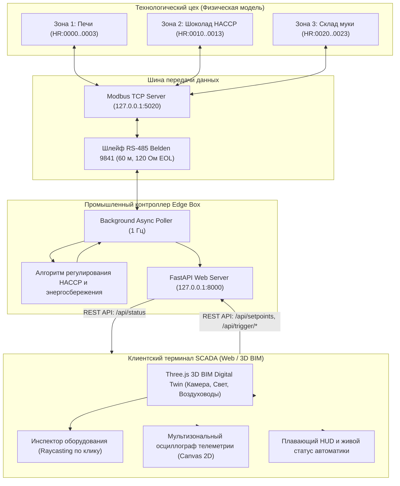

# Архитектура решения // Edge BMS SCADA Микроклимата

## 1. Концепция системы

Проект представляет собой программно-аппаратный комплекс диспетчеризации и предиктивного управления микроклиматом (Edge Box BMS / HVAC) для кондитерских производств Центральной Азии. 

Система решает ключевые производственные задачи:
1. **Предотвращение брака глазури (HACCP):** удержание температуры продукта в критическом коридоре 18.5 .. 19.5 °C при тепловых ударах от смежного горячего цеха выпечки.
2. **Защита сыпучего сырья от сырости:** предотвращение слеживания и комкования муки и сахара на складе (удержание влажности строго < 50 % Rh) при открытии ворот рампы в сырую погоду.
3. **Энергоэффективность:** автоматический перевод чиллера в экономичный ночной режим (+23.5 °C), снижающий энергопотребление на ~28%.
4. **Наглядность диспетчеризации:** интерактивный 3D BIM цифровой двойник цеха с трассировкой воздуховодов HVAC, инспекцией оборудования по клику и аналитическим осциллографом.

---

## 2. Диаграмма потоков данных

---

## 3. Модули системы

### 3.1. Физическая модель и Modbus-сервер (`simulator/climate_room.py`)
- Запускается на `127.0.0.1:5020`.
- Моделирует нелинейную физику 3 помещений:
  - Тепловой поток от печей и вытяжную тягу.
  - Кондуктивный теплоперенос через перегородку между цехом выпечки и шоколадным залом.
  - Подсос влажного уличного воздуха при открытии ворот рампы.
  - Адсорбционную осушку ротором DH-301.

### 3.2. Веб-контроллер и API-шлюз (`web/server.py`)
- Запускается на `127.0.0.1:8000` на базе FastAPI / Uvicorn.
- Выполняет постоянный асинхронный опрос Modbus-регистров с частотой 1 раз в секунду.
- Реализует логику термостата/регулятора:
  - Автоматический расчет мощности чиллера (`z2_ac`) по дельте `(T_fact - T_target)`.
  - Предиктивное форсирование осушителя (`z3_dehum`) при флаге открытия ворот (`bay_door_open`).
  - Управление дневной / ночной уставкой.
- Ведет кольцевой буфер истории (30 отсчетов) для отрисовки графиков и журнал телеграмм.

### 3.3. Пользовательский интерфейс SCADA (`web/static/`)
- **`css/bms.css`:** Промышленная темная палитра, адаптивная сетка технологических зон, стили стеклянных оверлеев и панели инспектора.
- **`js/bim-scene.js`:** 3D-модель цеха на Three.js (r128):
  - Архитектурный срез ограждающих конструкций.
  - Инженерная сеть вентиляции с зелеными VAV-боксами и диффузорами.
  - Динамическая кинематика (открытие печей, подъем ворот, движение тортов по конвейеру).
  - Raycaster для кликабельной инспекции агрегатов и фокуса камеры.
- **`js/telemetry.js`:** Polling API, реактивное обновление HUD и аппаратных карточек, отрисовка осциллографа.
- **`index.html`:** Семантический каркас интерфейса.
